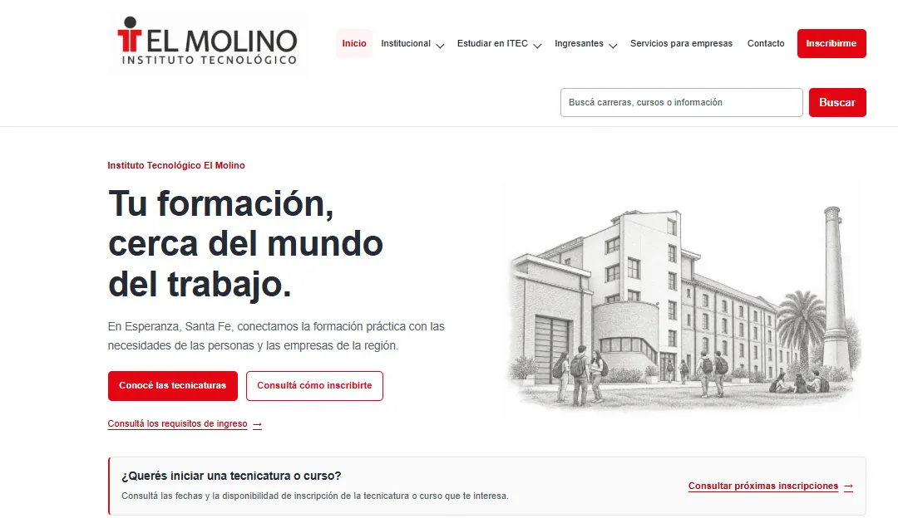
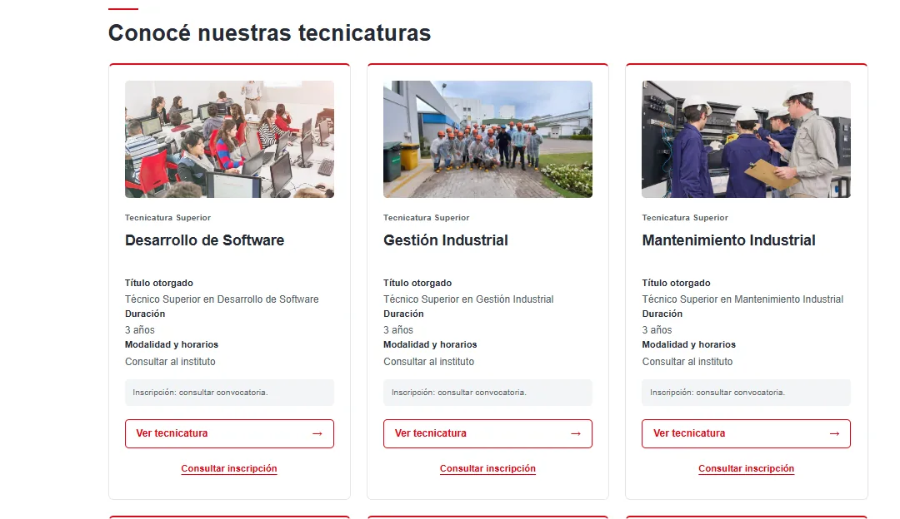
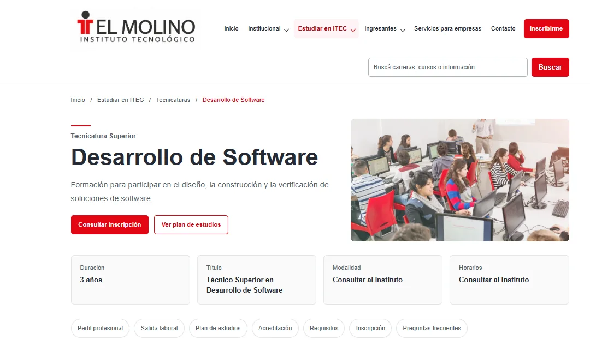
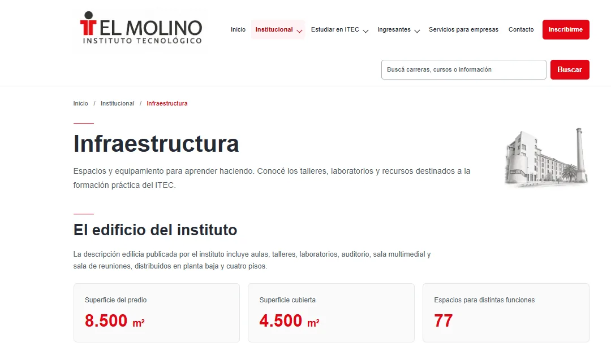
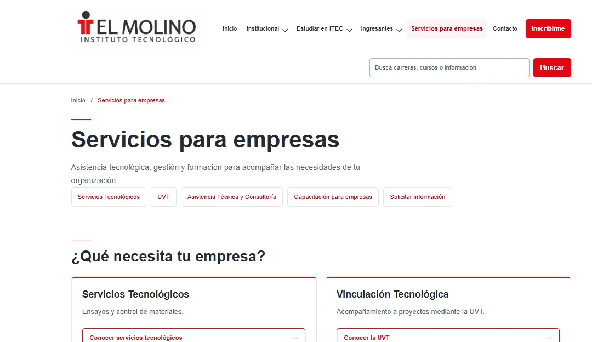
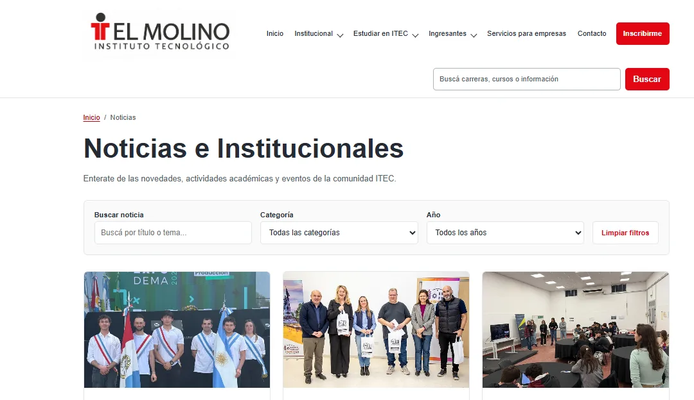

# Reingeniería del Ecosistema Digital ITEC

**Análisis, rediseño y desarrollo de un prototipo web institucional**

Proyecto integrador · Tecnicatura Superior en Desarrollo de Software · Programación II · 2026

<p align="center">
  
</p>

## Descripción

Desarrollamos una propuesta de reingeniería del sitio web del **Instituto Tecnológico El Molino (ITEC)**, de Esperanza, Santa Fe. Partimos de un análisis de la plataforma original para identificar oportunidades de mejora en la experiencia de usuario, la organización de los contenidos, la accesibilidad, la navegación y la consistencia visual.

A partir de este diagnóstico diseñamos una nueva estructura de navegación y construimos un **prototipo funcional** con las principales secciones institucionales y académicas. El proyecto está orientado a facilitar la consulta de información para estudiantes, futuros ingresantes, empresas y la comunidad.

## Objetivos del proyecto

- Simplificar los recorridos de navegación y destacar las acciones principales.
- Reorganizar la información académica e institucional con una estructura clara.
- Mejorar la jerarquía visual y mantener criterios de diseño consistentes.
- Incorporar búsqueda de contenidos, filtros y componentes interactivos.
- Adaptar la presentación a distintos tamaños de pantalla.
- Reutilizar componentes y organizar el código para facilitar su mantenimiento.

## Análisis y soluciones implementadas

Como primera etapa analizamos las secciones de Inicio, Institucional, Formación, Servicios y Contacto. Registramos problemas relacionados con el espacio disponible, la jerarquización de la información, los formularios, la localización de contenidos y la navegación.

| Área | Desarrollo realizado |
| --- | --- |
| **Inicio** | Reorganización de la portada con accesos a tecnicaturas, requisitos, consultas, noticias y servicios. |
| **Navegación** | Menú estructurado en Institucional, Estudiar en ITEC, Ingresantes, Servicios para empresas y Contacto. |
| **Tecnicaturas** | Presentación de seis carreras en tarjetas y páginas individuales con información académica. |
| **Infraestructura** | Organización visual de laboratorios y equipamiento, con visor interactivo de fotografías. |
| **Noticias** | Tarjetas de publicaciones, búsqueda, filtros por categoría y año, paginación y vista de detalle. |
| **Capacitaciones** | Tarjetas dinámicas, filtros y ventanas con información de cada propuesta. |
| **Servicios para empresas** | Secciones diferenciadas para presentar servicios y acceder a consultas. |
| **Contacto** | Organización de medios de contacto y validación de formularios. |
| **Búsqueda general** | Índice local con resultados y sugerencias, sin distinguir tildes ni mayúsculas. |

El rediseño integra además estructuras HTML semánticas, controles de navegación por teclado y estilos adaptativos.

## Capturas del prototipo

Las siguientes pantallas corresponden al sitio web desarrollado para el proyecto y muestran la estructura de navegación, las páginas académicas y los módulos de información.

<table>
  <tr>
    <td width="50%">
      
      <p align="center"><strong>Tecnicaturas</strong></p>
    </td>
    <td width="50%">
      
      <p align="center"><strong>Desarrollo de Software</strong></p>
    </td>
  </tr>
  <tr>
    <td>
      
      <p align="center"><strong>Infraestructura</strong></p>
    </td>
    <td>
      
      <p align="center"><strong>Servicios para empresas</strong></p>
    </td>
  </tr>
  <tr>
    <td colspan="2" align="center">
      
      <p align="center"><strong>Noticias e institucionales</strong></p>
    </td>
  </tr>
</table>

## Tecnologías utilizadas

| Tecnología | Aplicación |
| --- | --- |
| **HTML5** | Estructura de páginas y contenido semántico. |
| **CSS3** | Maquetación, diseño responsive y estilos compartidos. |
| **JavaScript** | Navegación, carga de componentes, filtros, búsqueda, formularios e interacciones. |
| **JSON** | Datos de noticias, capacitaciones e índice de búsqueda. |
| **Git y GitHub** | Control de versiones e integración del trabajo colaborativo. |

El frontend está desarrollado con **HTML, CSS y JavaScript sin frameworks**.

## Arquitectura y funcionalidades

### Componentes reutilizables

Centralizamos la cabecera y el pie de página en `componentes/estructura.html`. Desde `js/componentes.js` utilizamos `fetch()` para cargar las plantillas, insertarlas en las páginas y resolver las rutas de sus enlaces y recursos. De esta manera, mantenemos una estructura de navegación común en el sitio.

### Buscador general

Implementamos un buscador basado en `datos/busqueda.json`. Las funciones de JavaScript normalizan las consultas para comparar texto sin distinguir entre mayúsculas, minúsculas y tildes. También incorporamos sugerencias durante la escritura.

### Contenido dinámico

Las noticias y capacitaciones se organizan en archivos JSON y se representan dinámicamente mediante JavaScript.

- **Noticias:** búsqueda, filtros por categoría y año, paginación y detalle de publicaciones.
- **Capacitaciones:** filtros, tarjetas informativas y ventanas de detalle.
- **Inicio:** presentación de noticias destacadas a partir de los datos de publicaciones.

### Formularios e interacción

Los formularios incorporan validaciones del lado del cliente y mensajes para orientar al usuario. En Contacto y Capacitaciones, las consultas se preparan para su revisión y envío desde la aplicación de correo del usuario. Los formularios de boletín, novedades y preinscripción implementan el flujo de interacción como **simulación académica**, sin almacenamiento de datos ni envío automático.

La sección Infraestructura incluye un visor de imágenes; la navegación incorpora menús desplegables y controles interactivos.

## Estructura del repositorio

```text
Refactorizacion_pagina_ITEC/
├── index.html
├── componentes/
│   └── estructura.html
├── css/
├── datos/
│   ├── busqueda.json
│   ├── capacitaciones.json
│   └── noticias.json
├── img/
├── js/
└── paginas/
    └── carreras/
```

- **`componentes/`:** estructuras HTML compartidas.
- **`css/`:** hojas de estilo generales y específicas.
- **`datos/`:** contenido estructurado para los módulos dinámicos.
- **`img/`:** fotografías, ilustraciones y recursos del sitio.
- **`js/`:** lógica de navegación, búsqueda, filtros y formularios.
- **`paginas/`:** secciones internas y páginas de las carreras.

## Ejecución local

El prototipo utiliza `fetch()` para cargar componentes y archivos JSON, por lo que se ejecuta mediante un servidor HTTP local.

**1. Clonar el repositorio**

```bash
git clone https://github.com/MCammisiMicaela/Refactorizacion_pagina_ITEC.git
cd Refactorizacion_pagina_ITEC
```

**2. Iniciar un servidor local**

Con Python 3:

```bash
python -m http.server 8000
```

También puede ejecutarse utilizando la extensión **Live Server** de Visual Studio Code.

**3. Abrir el sitio**

Acceder a **http://localhost:8000/** desde el navegador.

## Equipo de desarrollo

El proyecto fue realizado por estudiantes de tercer año de la **Tecnicatura Superior en Desarrollo de Software**:

- **Malena Breques**
- **Micaela Cammisi**
- **Brian Franzen**
- **Agostina Landra**

Trabajamos en el análisis del sitio original, la definición de mejoras, el diseño del prototipo y la integración de sus distintas secciones, utilizando Git y GitHub para organizar el desarrollo colaborativo.

### Aportes al desarrollo

En el historial del repositorio se encuentran registrados los desarrollos de Formación Profesional y Vinculación institucional realizados por Malena Breques; los módulos de Noticias y Capacitaciones desarrollados por Agostina Landra; y los comentarios de código incorporados por Brian Franzen.

**Micaela Cammisi** participó principalmente en:

- Desarrollo de la sección **Infraestructura**, sus estilos y el visor de imágenes.
- Desarrollo de **Tecnicaturas** y las páginas individuales de las carreras.
- Desarrollo de la sección **Servicios para empresas**.
- Unificación de estilos CSS, integración de secciones y correcciones generales.

Commits del desarrollo:

- [Infraestructura](https://github.com/MCammisiMicaela/Refactorizacion_pagina_ITEC/commit/808ff8528a)
- [Tecnicaturas y carreras](https://github.com/MCammisiMicaela/Refactorizacion_pagina_ITEC/commit/3289cda8ca)
- [Servicios para empresas](https://github.com/MCammisiMicaela/Refactorizacion_pagina_ITEC/commit/305c4103c3)
- [Unificación de estilos](https://github.com/MCammisiMicaela/Refactorizacion_pagina_ITEC/commit/859b6db99d)

## Información académica

**Proyecto:** Reingeniería del Ecosistema Digital ITEC  
**Carrera:** Tecnicatura Superior en Desarrollo de Software  
**Materia:** Programación II  
**Docente:** Nicolás Zeballos  
**Ciclo lectivo:** 2026  
**Entrega:** 7 de octubre de 2026

El proyecto se presentó junto con un informe de análisis que documenta el diagnóstico del sitio original, las propuestas de mejora, la nueva estructura de navegación y las interfaces desarrolladas.
